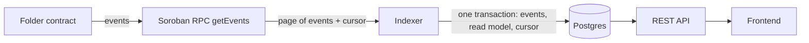

# Indexer-Backend

The API and event indexer for **Folder**, a decentralized portfolio tool on Stellar. Users
claim a `.folder` name, pick a template and mint their portfolio as an NFT through the
[Folder Soroban contract](https://github.com/D-Indexer/Indexer-Contract). This service reads
that contract's events from Soroban RPC into Postgres, serves folders, templates and
portfolios over a REST API, and pins portfolio files to IPFS for the
[frontend](https://github.com/D-Indexer/Indexer-Frontend).

**Testnet contract:** [`CDDQK74SMH4RB4HYLHM6BYZPTAMDMRISHW5Q274KADVZVFD57K43O6KV`](https://stellar.expert/explorer/testnet/contract/CDDQK74SMH4RB4HYLHM6BYZPTAMDMRISHW5Q274KADVZVFD57K43O6KV)
(from Indexer-Contract [`deployments/testnet.json`](https://github.com/D-Indexer/Indexer-Contract/blob/main/deployments/testnet.json))

## Status

| Area                                                     | Status | Notes                                                                                                                         |
| -------------------------------------------------------- | ------ | ----------------------------------------------------------------------------------------------------------------------------- |
| Index all 8 contract events from testnet                 | ✅     | `init`, `adm_add`, `adm_rm`, `folder_cl`, `tmpl_reg`, `tmpl_set`, `port_mint`, `port_upd`; tested against real testnet events |
| Idempotent, transactional indexing                       | ✅     | Events keyed by RPC event id; cursor saved in the same transaction                                                            |
| RPC retention-gap detection and recovery                 | ✅     | Halts with a clear error or skips ahead; [recovery steps](docs/operations.md#retention-gap)                                   |
| REST API: folders, portfolios, templates, health         | ✅     | [docs/api.md](docs/api.md)                                                                                                    |
| IPFS upload with type and size checks                    | ✅     | Unauthenticated, no rate limit yet                                                                                            |
| Local stack with `docker compose up`                     | ✅     | Postgres, IPFS, API, indexer, healthchecks                                                                                    |
| CI: typecheck, lint, tests with Postgres, Docker build   | ✅     |                                                                                                                               |
| Nightly testnet integration job                          | 🟡     | Workflow added; first scheduled run pending                                                                                   |
| Admin set                                                | 🟡     | Indexed into `admins`; no endpoint yet                                                                                        |
| Pagination, rate limiting, OpenAPI spec, metrics, search | ⬜     | [Open issues](https://github.com/D-Indexer/Indexer-Backend/issues)                                                            |
| Backfill beyond the RPC retention window                 | ⬜     | Open issue                                                                                                                    |
| Mainnet                                                  | ⬜     | Contract is on testnet only                                                                                                   |

## Quick start

Requires Docker. No `.env` needed; defaults point at the testnet contract.

```bash
git clone https://github.com/D-Indexer/Indexer-Backend.git && cd Indexer-Backend
docker compose up --build -d
curl localhost:3000/health
```

When `indexer.lastLedger` in the health response is close to the chain tip, try
`curl localhost:3000/templates`. Stop with `docker compose down` (add `-v` to delete data).
For development without containers, see [CONTRIBUTING.md](CONTRIBUTING.md#set-up).

## How the indexer works



1. The indexer asks Soroban RPC for the contract's events, starting from its saved cursor.
2. Each page is written in **one transaction**. Every event is inserted into
   `contract_events` under its unique RPC event id, newly seen events update `folders`,
   `templates`, `portfolios` and `admins`, and the new cursor is saved. Replays are no-ops and
   a crash never leaves partial writes.
3. Events that can't be decoded are stored as `rejected` instead of blocking the indexer.
4. RPC only keeps about 7 days of ledgers. If the indexer is down longer than that, it stops
   with a `retention_gap` status rather than silently skipping events.

Details in [docs/architecture.md](docs/architecture.md).

## Documentation

- [Architecture](docs/architecture.md): components, event mapping, indexing guarantees, data model
- [API](docs/api.md): every endpoint with examples and error codes
- [Configuration](docs/configuration.md): environment variables and testnet values
- [Operations](docs/operations.md): indexer recovery, database, IPFS
- [Contributing](CONTRIBUTING.md): setup, tests, PR guidelines

## Contributing

Issues are labelled `good first issue`, `difficulty: medium` and `difficulty: hard`, and each
lists the files involved, acceptance criteria and expected tests. Start with
[CONTRIBUTING.md](CONTRIBUTING.md), pick an
[open issue](https://github.com/D-Indexer/Indexer-Backend/issues) and comment that you're
taking it.

## License

[MIT](LICENSE)
