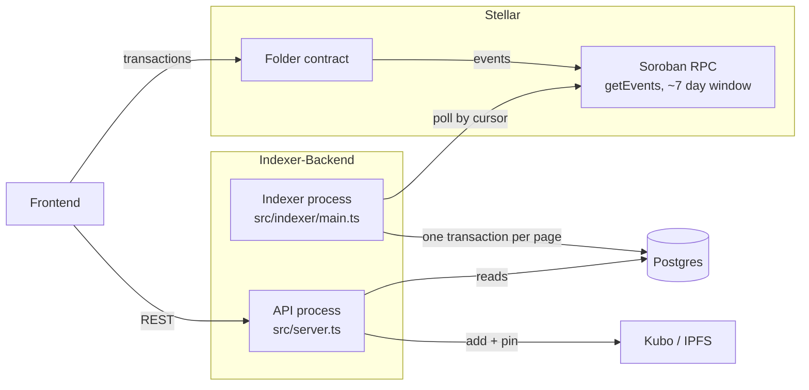

# Architecture

Indexer-Backend is the read side of Folder. The
[Folder contract](https://github.com/D-Indexer/Indexer-Contract) on Stellar is the source of
truth; this service turns its events into a Postgres read model and serves it over REST,
and pins portfolio files to IPFS for the [frontend](https://github.com/D-Indexer/Indexer-Frontend).

Two processes share one image and one database. They scale and restart independently, and
the API never talks to the RPC.

| Path                                            | Responsibility                                                                                                    |
| ----------------------------------------------- | ----------------------------------------------------------------------------------------------------------------- |
| `src/indexer/rpc.ts`                            | JSON-RPC client for `getEvents` / `getHealth`: timeouts, retries with backoff, URL redaction                      |
| `src/indexer/decode.ts`                         | Decode raw events (Symbol topic, ScVec data) into typed objects                                                   |
| `src/indexer/handlers.ts`                       | Apply one decoded event to the read model                                                                         |
| `src/indexer/stellar.ts`                        | Poll loop, page transactions, cursor, retention-gap handling                                                      |
| `src/indexer/cli.ts`                            | `status`, `reset-cursor`, `healthcheck`                                                                           |
| `src/routes`, `src/controllers`, `src/services` | REST API: routing, validation, SQL                                                                                |
| `src/config/env.ts`                             | Zod schema for all configuration; the process exits on invalid config                                             |
| `database/schema.sql`                           | The only schema definition; applied by `npm run db:migrate`, the indexer at startup and the compose Postgres init |

## Events

The contract's event format is defined in Indexer-Contract
[`docs/EVENTS.md`](https://github.com/D-Indexer/Indexer-Contract/blob/main/docs/EVENTS.md).
Every event has one `Symbol` topic and an `ScVec` of data fields. Fields are decoded by
position; trailing fields are ignored because the contract only appends.

| Topic       | Data (in order)                                                    | Effect                                                 |
| ----------- | ------------------------------------------------------------------ | ------------------------------------------------------ |
| `init`      | `admin`                                                            | insert into `admins`                                   |
| `adm_add`   | `admin`, `new_admin`                                               | insert `new_admin` into `admins`                       |
| `adm_rm`    | `admin`, `target`                                                  | delete `target` from `admins`                          |
| `folder_cl` | `owner`, `folder_name`                                             | upsert `folders`                                       |
| `tmpl_reg`  | `template_id: u32`, `metadata_uri`, `creator` (appended; optional) | upsert `templates`                                     |
| `tmpl_set`  | `owner`, `template_id: u32`                                        | set `folders.template_id` and `portfolios.template_id` |
| `port_mint` | `owner`, `template_id: u32`, `ipfs_cid`                            | upsert `portfolios`; set `folders.template_id`         |
| `port_upd`  | `owner`, `ipfs_cid`                                                | update `portfolios.ipfs_cid`                           |

Timestamps (`claimed_at`, `minted_at`, `updated_at`, …) are the event's `ledgerClosedAt`.
Unknown topics are stored with status `ignored`, so new contract events don't break the
indexer.

To support a new event: add a case to `decode.ts` and `handlers.ts`, a table or column to
`database/schema.sql` if needed, and tests in `decode.test.ts` and `indexer.db.test.ts`.

## How indexing works

1. **Pick a start.** Use the saved RPC paging cursor if there is one. Otherwise use a
   ledger set by `reset-cursor`, then `INDEXER_START_LEDGER`, then the oldest ledger the
   RPC retains.
2. **Fetch a page** with `getEvents`, filtered to `FOLDER_CONTRACT_ID`
   (`INDEXER_PAGE_LIMIT` events).
3. **Write the page in one transaction.** Each event is inserted into `contract_events`
   keyed by its RPC event id (a TOID encoding ledger, transaction, operation and event
   index) with `ON CONFLICT DO NOTHING`. Only newly inserted events are applied to the read
   model. The new cursor is written in the same transaction.
4. **Repeat** while pages are full, then sleep `INDEXER_POLL_INTERVAL_MS`.

What this guarantees:

- **Idempotent.** Replaying a page after a crash, or rewinding the cursor, skips events
  already stored. The read model only changes once per event.
- **Atomic.** A failure anywhere in a page rolls back its events, read-model writes and
  cursor together, and the page is retried.
- **No poison pills.** An event that can't be decoded, or that Postgres rejects
  deterministically (constraint or data error), is stored with status `rejected` and its
  error, and indexing continues. `SELECT * FROM contract_events WHERE status = 'rejected'`
  lists them.
- **The cursor always advances.** The RPC returns a cursor even for an empty page, so a quiet
  contract doesn't leave the cursor behind the retention window.
- **Backoff.** RPC calls are retried 3× for timeouts, network errors, 429 and 5xx. Failed
  polls back off exponentially up to `INDEXER_MAX_BACKOFF_MS`.

### Retention window

Soroban RPC only serves recent ledgers (testnet: 120,960 ledgers, about 7 days). If the
saved cursor falls outside that window, for example after the indexer has been down for a
week, the events in between are no longer available from `getEvents`. By default the indexer
halts and reports `retention_gap`; see [operations](operations.md#retention-gap). Backfilling
from archive data is not implemented yet.

## Data model

| Table             | Key                     | Source                                                                                         |
| ----------------- | ----------------------- | ---------------------------------------------------------------------------------------------- |
| `contract_events` | RPC event id            | every event: ledger, close time, tx hash, raw topic/value XDR, decoded data, status, error     |
| `folders`         | `owner` (unique `name`) | `folder_cl`, `tmpl_set`, `port_mint`                                                           |
| `templates`       | `id`                    | `tmpl_reg`                                                                                     |
| `portfolios`      | `owner`                 | `port_mint`, `port_upd`, `tmpl_set`                                                            |
| `admins`          | `address`               | `init`, `adm_add`, `adm_rm`                                                                    |
| `indexer_state`   | `key`                   | `cursor`, `last_ledger`, `last_success_at`, `status`, `last_error`, `start_ledger`, `last_gap` |

Template ids are `BIGINT` because the contract uses `u32`. There are no foreign keys between
`folders` and `portfolios`: an indexer that starts partway through history can see a mint
whose claim is outside the window.

## Design decisions

- **The ledger is the source of truth.** Postgres is a rebuildable read model. Every
  applied event is kept in `contract_events` with its raw XDR.
- **Raw RPC, SDK for XDR.** The SDK's `getEvents` replaces `contractId` and `topic` with
  objects. Calling the JSON-RPC method directly keeps the raw XDR we store, and the SDK is
  used only to decode `ScVal`s.
- **Configuration is validated once at startup** (Zod). A misconfigured process exits
  instead of running half-configured.
- **Graceful shutdown.** On SIGTERM the indexer waits for the in-flight page before closing
  the pool, and the API stops accepting connections first. Both stop after
  `SHUTDOWN_TIMEOUT_MS`.
